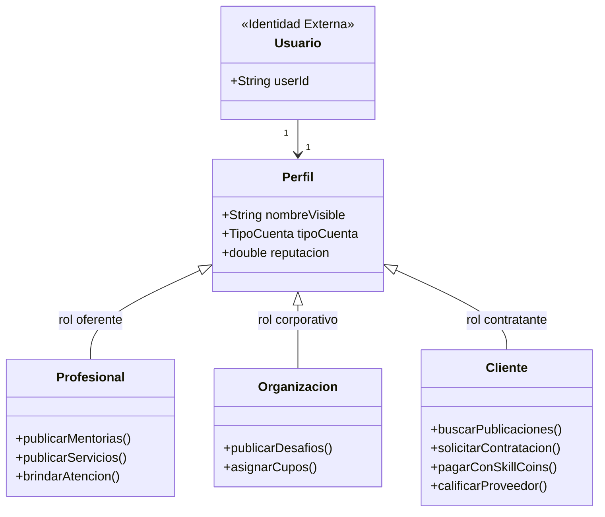

# Alcance, Fuera de Alcance y Actores del Sistema (SkillSwap)

**Materia:** Procesos de Desarrollo de Software (PDS - UADE)  
**Responsable:** Andy (§2, §4.2, §16)  
**Documento de referencia:** `TP_PDS_SkillSwap.pdf`  

---

## 1. Alcance del Sistema (Dentro de Alcance)

El sistema **SkillSwap** es una plataforma tipo *Marketplace* colaborativo orientada al intercambio de conocimientos, mentorías, servicios profesionales y desafíos de organizaciones utilizando una moneda virtual propia (**SkillCoins**).

El foco principal de desarrollo y evaluación es el **diseño arquitectónico de backend**, aplicando **Clean Architecture (arquitectura limpia)** en módulos desacoplados, patrones de diseño GoF y principios GRASP/SOLID.

### Módulos y Funcionalidades Dentro de Alcance:
1. **Gestión de Identidad y Perfiles (§4.1):**
   - Registro de perfiles vinculados a un identificador externo (`userId`).
   - Configuración de nombre visible, biografía, zona horaria, habilidades, intereses y disponibilidad horaria.
   - Distinción entre perfiles individuales (**Profesionales**) y corporativos (**Organizaciones**).
   - Baja lógica de perfiles: preservación inmutable del histórico de transacciones, contrataciones y calificaciones.
   - Vista unificada de Perfil Público con reputación, publicaciones activas e histórico resumido (*Patrón Facade*).
2. **Catálogo de Publicaciones y Búsqueda (§4.2, §4.3):**
   - Tipos de publicación: Mentorías, Servicios y Desafíos.
   - Ciclo de vida con máquina de estados (*Patrón State*): `BORRADOR` $\rightarrow$ `PUBLICADA` $\rightleftarrows$ `PAUSADA` $\rightarrow$ `CERRADA` / `CANCELADA`.
   - Estructura jerárquica de categorías y subcategorías (*Patrón Composite*).
   - Búsqueda filtrada (texto, categoría, modalidad, precio, reputación) y paginada sin problemas de consulta $N+1$.
3. **Ciclo de Contratación y Reservas (§4.4, §4.5):**
   - Solicitud de publicación con franja horaria y mensaje.
   - Gestión de estados de contratación (*Patrón State*): `PENDIENTE` $\rightarrow$ `ACEPTADA` $\rightarrow$ `CONFIRMADA` $\rightarrow$ `EN_CURSO` $\rightarrow$ `COMPLETADA` (o `RECHAZADA` / `CANCELADA`).
   - Bloqueo de franjas horarias y control de concurrencia optimista (*Optimistic Locking* con `@Version`) sobre el cupo.
   - Reprogramación de común acuerdo antes del inicio.
4. **Billetera, Pagos y Precios (§4.4, §5):**
   - Billetera (`Wallet`) por usuario con saldo en SkillCoins (invariante: nunca negativo).
   - Transacción atómica de pago: débito al cliente y crédito al proveedor en una única unidad de trabajo.
   - Políticas de reintegro intercambiables (*Patrón Strategy*): 100%, 50% o 0% según ventana de anticipación.
   - Promociones acumulables sobre el precio base (*Patrón Decorator*).
5. **Calificaciones y Reputación Verificada (§4.4, §5):**
   - Calificación bilateral exclusiva para participantes de contrataciones con estado `COMPLETADA`.
   - Restricción estricta de una única calificación por parte y prohibición de autocalificación.
   - Recálculo automático de la reputación ponderada como promedio aritmético de calificaciones verificadas.
6. **Sistema de Recomendación (§4.3):**
   - Algoritmos intercambiables en tiempo de ejecución (*Patrón Strategy*): Afinidad por Habilidades y Popularidad Reciente.
7. **Notificaciones y Eventos de Dominio (§4.6):**
   - Publicación de eventos de dominio ante transiciones clave (*Patrón Observer*).
   - Canales simulados (Email, Push, Notificación Interna) creados mediante fábrica (*Simple Factory*) y desacoplados (*Patrón Adapter*).
8. **Persistencia y Calidad (§8, §12):**
   - Base de datos relacional (MySQL 8 para entorno productivo / Docker; H2 en memoria para tests de integración).
   - Migraciones versionadas automáticas con Flyway (`V<n>__descripcion.sql`).
   - Cobertura de tests unitarios e integración $\ge 80\%$ en dominio y aplicación verificado con JaCoCo.

---

## 2. Fuera de Alcance (Exclusiones Explícitas - §16)

De acuerdo con las especificaciones del TP y las pautas de la cátedra para acotar la complejidad accidental y focalizarse en la arquitectura de software:

1. **Autenticación Real y Seguridad Criptográfica (§10, §16):**
   - No se implementa registro con contraseñas, hashing (bcrypt/argon2), recuperación de claves ni protocolos complejos como OAuth2 o JWT.
   - La identidad del usuario se provee mediante un **Adaptador Mock de Identidad** (`MockServicioIdentidadAdapter`) que suministra el `userId` activo en sesión a los controladores.
2. **Dinero Real y Pasarelas de Pago Externas (§5, §16):**
   - No hay integración con procesadores financieros reales (Stripe, Mercado Pago, PayPal ni transferencias bancarias).
   - Se opera exclusivamente con la moneda virtual interna **SkillCoins**; la carga de créditos se simula mediante un adaptador de pasarela mock.
3. **Chat y Mensajería Instantánea en Tiempo Real (§16):**
   - No se implementan sockets, WebSockets ni salas de chat interactivo entre usuarios.
   - La comunicación se limita a los mensajes/objetivos fijados en la solicitud de contratación y a las notificaciones emitidas por el sistema.
4. **Diseño Visual de Interfaz y Tecnologías Web Frontend (§10, §16):**
   - No se desarrollan páginas web, HTML/CSS, React, Vue ni aplicaciones móviles.
   - Se utiliza el **Mock UI Kit** provisto por la cátedra (Swing o JavaFX) para interactuar con los controladores de aplicación mediante interfaces Java.
5. **Infraestructura Cloud y Orquestación Compleja (§16):**
   - Fuera de alcance: despliegues en AWS, GCP, Azure, clusters de Kubernetes o configuraciones de alta disponibilidad en producción.
   - El despliegue local se realiza mediante un `docker-compose.yml` estándar para MySQL.
6. **Frameworks de Inyección de Dependencias (Spring / Guice / CDI) (§6):**
   - **Prohibido el uso de Spring Boot**. La inyección de dependencias y el armado del grafo de objetos se realiza manualmente en la clase `Main` (*Composition Root*).

---

## 3. Actores del Sistema (§2, §4.2)

Los actores identificados que interactúan con SkillSwap son:

### 3.1. Profesional (Oferente Individual)
- **Definición:** Usuario individual que posee habilidades técnicas, académicas u oficios y ofrece su tiempo en forma de **Mentorías** o **Servicios**.
- **Acciones principales:**
  - Crear y publicar ofertas de mentoría y servicio con disponibilidad horaria y precio base.
  - Aceptar o rechazar solicitudes recibidas.
  - Iniciar y completar sesiones de contratación.
  - Percibir créditos en su billetera al completarse la sesión.
  - Calificar al cliente al finalizar la contratación.

### 3.2. Organización (Oferente Institucional)
- **Definición:** Empresa, institución educativa u ONG que participa en la plataforma para proponer **Desafíos**.
- **Acciones principales:**
  - Crear y gestionar desafíos colectivos con cupos múltiples y requisitos específicos.
  - Revisar postulaciones y aceptar participantes.
  - Gestionar franjas y cupos asignados.

### 3.3. Cliente (Contratante)
- **Definición:** Usuario que busca adquirir conocimientos, resolver problemas o participar en actividades ofertadas en la plataforma.
- **Acciones principales:**
  - Explorar el catálogo, aplicar filtros y visualizar recomendaciones personalizadas.
  - Solicitar una contratación eligiendo una franja horaria disponible y especificando objetivos.
  - Pagar la contratación debitando fondos de su billetera tras la aceptación del proveedor.
  - Proponer reprogramaciones en caso de fuerza mayor.
  - Calificar el servicio recibido una vez completado.

### 3.4. Usuario Dual (Cliente y Proveedor a la vez)
- **Definición:** Modelo central de la economía colaborativa de SkillSwap. Un mismo usuario (`userId`) posee **un único perfil y una única billetera** (`Wallet`), pudiendo actuar como oferente de sus propios saberes y como cliente de otros colegas.
- **Regla de negocio:** Un usuario no puede solicitar ni contratar sus propias publicaciones (detección de conflicto de interés e invalidación en dominio).

### 3.5. Administrador / Sistema (Actor Secundario / Automático)
- **Definición:** Componente del sistema responsable de mantener el catálogo de categorías globales, coordinar eventos y procesar transiciones temporales (mediante reloj inyectable).
