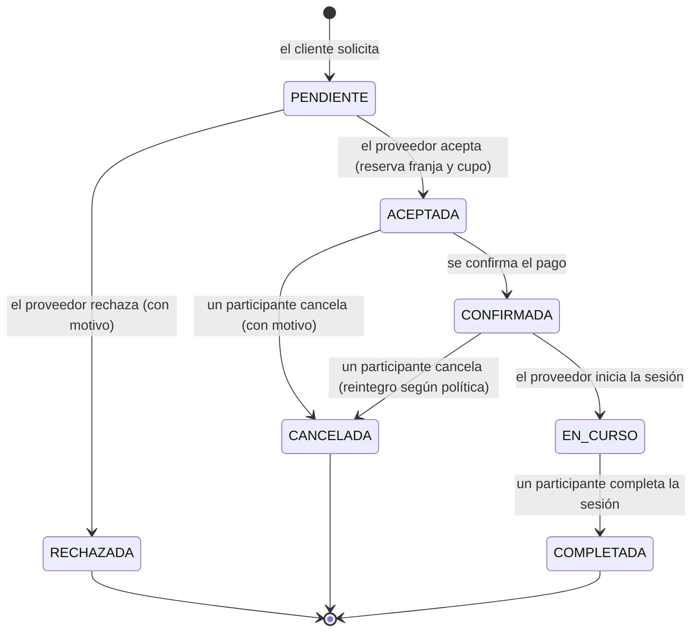

# Contratación: historias de usuario y estados

Cubre el ciclo de una contratación, desde que un cliente pide una publicación hasta que la sesión termina. Las reglas salen del enunciado. Lo que el enunciado no define está marcado como **decisión pendiente** y se resume al final.

## Actores

- **Cliente**: el usuario que solicita la publicación y paga.
- **Proveedor**: el autor de la publicación (un profesional, o una organización en el caso de un desafío).
- **Participantes**: el cliente y el proveedor de una contratación. Nadie más puede actuar sobre ella.

## Historias

### HU-C01. Solicitar una publicación

**Como** cliente, **quiero** solicitar una publicación indicando un mensaje, la franja que elijo y mi objetivo, **para** contratar una mentoría, un servicio o un desafío.

Criterios de aceptación:

1. Dada una publicación `PUBLICADA`, cuando la solicito con mensaje, franja y objetivo, entonces se crea una contratación `PENDIENTE` con el precio final calculado para ese cliente y publicación, y el proveedor recibe la notificación de solicitud recibida.
2. Dado que soy el autor de la publicación, cuando intento solicitarla, entonces se rechaza.
3. Dada una publicación en `BORRADOR`, `PAUSADA`, `CERRADA` o `CANCELADA`, cuando intento solicitarla, entonces se rechaza.
4. La franja elegida tiene que ser una de las franjas de la publicación.
5. La creación queda en el historial con fecha y actor.

> **Decisión pendiente D1**: si la franja ya está ocupada o el cupo está agotado, ¿se rechaza al solicitar o recién al aceptar?

### HU-C02. Aceptar una solicitud

**Como** proveedor, **quiero** aceptar una solicitud, **para** reservarle el lugar al cliente.

Criterios de aceptación:

1. Dada una contratación `PENDIENTE` de una publicación mía, cuando la acepto, entonces pasa a `ACEPTADA`, la franja queda ocupada, se descuenta un lugar del cupo y el cliente recibe la notificación de aceptación.
2. La reserva de la franja y del cupo y el cambio de estado se confirman juntos: si algo falla, no queda nada a medias.
3. Dado que la franja ya está ocupada o el cupo está agotado, cuando la acepto, entonces se rechaza y la contratación sigue `PENDIENTE`.
4. Dadas dos aceptaciones simultáneas por el último lugar del cupo, entonces solo una se confirma y la otra se rechaza (caso de aceptación 4).
5. Dado que no soy el proveedor, cuando intento aceptar, entonces se rechaza por falta de permiso.
6. Dada una contratación que no está `PENDIENTE`, cuando intento aceptarla, entonces se rechaza por transición inválida.

### HU-C03. Rechazar una solicitud

**Como** proveedor, **quiero** rechazar una solicitud con un motivo, **para** avisarle al cliente que no puedo tomarla.

Criterios de aceptación:

1. Dada una contratación `PENDIENTE` de una publicación mía, cuando la rechazo con un motivo, entonces pasa a `RECHAZADA` y el motivo queda en el historial.
2. El motivo es obligatorio.
3. Una contratación `RECHAZADA` ya no admite ninguna acción: solo se consulta su historial.

### HU-C04. Confirmar por pago

**Como** cliente, **quiero** que mi contratación quede confirmada cuando pago, **para** tener la sesión asegurada.

El pago es del área de wallet; acá solo se cubre el cambio de estado que provoca.

Criterios de aceptación:

1. Dada una contratación `ACEPTADA`, cuando se confirma el pago, entonces pasa a `CONFIRMADA` y el pago y el cambio de estado se confirman juntos. Si el precio es cero, no se crean movimientos, pero el estado avanza igualmente.
2. Dada una contratación en cualquier otro estado, cuando se intenta pagar, entonces se rechaza por transición inválida y no se mueve ningún saldo.

### HU-C05. Proponer una reprogramación

**Como** participante, **quiero** proponer otra franja, **para** cambiar el horario de la sesión antes de que empiece.

Criterios de aceptación:

1. Dada una contratación `ACEPTADA` o `CONFIRMADA`, cuando propongo otra franja libre de la misma publicación, entonces queda una propuesta pendiente y la otra parte recibe la notificación de reprogramación.
2. El estado de la contratación no cambia mientras la propuesta está pendiente.
3. Solo puede haber una propuesta pendiente a la vez.
4. Dada una contratación `EN_CURSO` o posterior, cuando intento proponer una reprogramación, entonces se rechaza por transición inválida.

### HU-C06. Responder una reprogramación

**Como** la otra parte, **quiero** aceptar o rechazar la propuesta, **para** que el cambio de horario solo pase si los dos estamos de acuerdo.

Criterios de aceptación:

1. Cuando acepto la propuesta, entonces la contratación pasa a la franja nueva, se libera la anterior y el cambio queda en el historial con fecha y actor.
2. Cuando la rechazo, entonces la contratación sigue con su franja original y la propuesta se descarta.
3. Quien propuso no puede aceptar su propia propuesta.
4. Si la franja propuesta se ocupó mientras tanto, aceptar se rechaza y la propuesta se descarta.

### HU-C07. Iniciar la sesión

**Como** participante, **quiero** marcar que la sesión empezó, **para** dejar registro de que se está prestando.

Criterios de aceptación:

1. Dada una contratación `CONFIRMADA`, cuando la inicio, entonces pasa a `EN_CURSO`.
2. Dada una contratación en cualquier otro estado, cuando intento iniciarla, entonces se rechaza por transición inválida.

3. Solo el proveedor puede iniciar la sesión (decisión D2).

### HU-C08. Completar la sesión

**Como** participante, **quiero** marcar que la sesión terminó, **para** habilitar las calificaciones y el comprobante.

Criterios de aceptación:

1. Dada una contratación `EN_CURSO`, cuando la completo, entonces pasa a `COMPLETADA`, cada participante puede calificar una vez y ambos reciben la notificación de sesión completada.
2. Dada una contratación en cualquier otro estado, cuando intento completarla, entonces se rechaza por transición inválida.

3. Cualquiera de los participantes puede completar la sesión, para que el cliente no quede sin poder calificar si el proveedor no la cierra (decisión D2).

### HU-C09. Cancelar una contratación

**Como** participante, **quiero** cancelar una contratación con un motivo, **para** liberar el lugar si no se va a hacer.

Criterios de aceptación:

1. Dada una contratación `ACEPTADA` o `CONFIRMADA`, cuando la cancelo con un motivo, entonces pasa a `CANCELADA`, se liberan la franja y el lugar del cupo, y la otra parte recibe la notificación de cancelación.
2. Si estaba `CONFIRMADA`, el cliente recibe el reintegro que corresponda según la política de anticipación (100 %, 50 % o 0 %). El cálculo es del área de wallet.
3. El motivo es obligatorio.
4. Una contratación `PENDIENTE`, `EN_CURSO`, `COMPLETADA`, `RECHAZADA` o `CANCELADA` no se puede cancelar. En `PENDIENTE` solo se acepta o se rechaza, como en la tabla del enunciado (decisión D3).

> **Decisión pendiente D4**: cuando cancela el proveedor, ¿el cliente recibe siempre el 100 % o se aplica la misma política de anticipación?

### HU-C10. Consultar el historial

**Como** participante, **quiero** ver el historial de una contratación, **para** saber qué pasó, cuándo y quién lo hizo.

Criterios de aceptación:

1. Muestra cada transición con fecha, actor, estado anterior, estado nuevo y motivo, de la más vieja a la más nueva.
2. Ningún registro del historial se puede editar ni borrar.
3. Solo los participantes pueden consultarlo.

### HU-C11. Listar mis contrataciones

**Como** cliente o proveedor, **quiero** ver mis contrataciones paginadas, **para** seguir las que tengo abiertas (en el caso del proveedor, es su panel de solicitudes).

Criterios de aceptación:

1. Como cliente, veo las contrataciones que solicité; como proveedor, las de mis publicaciones.
2. El listado es paginado y se puede filtrar por estado.

## Estados

La reprogramación no es un estado: es una propuesta que se acepta o se rechaza mientras la contratación está `ACEPTADA` o `CONFIRMADA`, y no la cambia de estado.

### Transiciones válidas

| Desde | Acción | Hacia | Quién | Condiciones |
| --- | --- | --- | --- | --- |
| (nueva) | solicitar | `PENDIENTE` | Cliente | Publicación `PUBLICADA`; el cliente no es el autor (D1) |
| `PENDIENTE` | aceptar | `ACEPTADA` | Proveedor | Franja libre y cupo disponible |
| `PENDIENTE` | rechazar | `RECHAZADA` | Proveedor | Motivo obligatorio |
| `ACEPTADA` | pagar | `CONFIRMADA` | Cliente | Saldo suficiente, sin cobro previo |
| `ACEPTADA` | cancelar | `CANCELADA` | Participante | Motivo obligatorio; libera franja y cupo |
| `ACEPTADA` o `CONFIRMADA` | reprogramar | (mismo estado) | Participante propone, la otra parte acepta | Franja nueva libre |
| `CONFIRMADA` | iniciar | `EN_CURSO` | Proveedor | |
| `CONFIRMADA` | cancelar | `CANCELADA` | Participante | Motivo obligatorio; reintegro según política (D4) |
| `EN_CURSO` | completar | `COMPLETADA` | Participante | Habilita calificaciones |

### Transiciones inválidas

Cualquier acción que no esté en la tabla anterior se rechaza con un error de transición inválida y no cambia nada. Por ejemplo:

| Estado | Acción | Por qué no |
| --- | --- | --- |
| `PENDIENTE` | pagar | Todavía no hay reserva |
| `PENDIENTE` | cancelar | Solo se acepta o se rechaza (D3) |
| `PENDIENTE` | iniciar | No está aceptada ni pagada |
| `ACEPTADA` | aceptar | Ya se aceptó |
| `CONFIRMADA` | pagar | Sería un doble cobro |
| `EN_CURSO` | cancelar | La sesión ya empezó |
| `EN_CURSO` | reprogramar | La sesión ya empezó |
| `COMPLETADA` | cualquier acción salvo consultar | Es un estado final |
| `RECHAZADA` o `CANCELADA` | cualquier acción salvo consultar | Es un estado final |

## Decisiones tomadas

| # | Pregunta | Decisión |
| --- | --- | --- |
| D2 | ¿Quién inicia y completa la sesión? | El proveedor inicia y cualquiera de los participantes completa: la sesión no arranca sin el proveedor, y el cliente no queda sin poder calificar si el proveedor no la cierra. |
| D3 | ¿El cliente puede retirar una solicitud `PENDIENTE`? | No, como en la tabla del enunciado: en `PENDIENTE` solo se acepta o se rechaza. |
| Reprogramación | ¿Es un estado o una propuesta? | Una propuesta: la contratación no cambia de estado mientras la otra parte responde, así los estados quedan como en la tabla del enunciado. |
| D6 | ¿Qué pasa si el proveedor ya gastó los créditos que debe reintegrar? | No hay escrow ni saldo negativo: el reintegro y la cancelación fallan juntos, y la contratación mantiene su estado y cupo hasta que el proveedor tenga saldo suficiente. |

## Decisiones pendientes

| # | Pregunta | Opciones |
| --- | --- | --- |
| D1 | ¿Cuándo se valida que la franja esté libre y haya cupo? | Al solicitar y al aceptar (el cliente se entera antes, pero se valida dos veces), o solo al aceptar (como dice el enunciado, que habla de reservar al aceptar). |
| D4 | Cuando cancela el proveedor, ¿cuánto se reintegra? | Siempre el 100 % al cliente, o la misma política de anticipación que cuando cancela el cliente. Se define junto con el área de wallet. |
| D5 | ¿Cómo se relacionan el cupo y las franjas? | Cupo por publicación (cantidad de contrataciones activas, cada franja la toma una sola), o cupo por franja (cada franja admite varias personas, como un taller). Se define junto con el área de publicaciones. |
