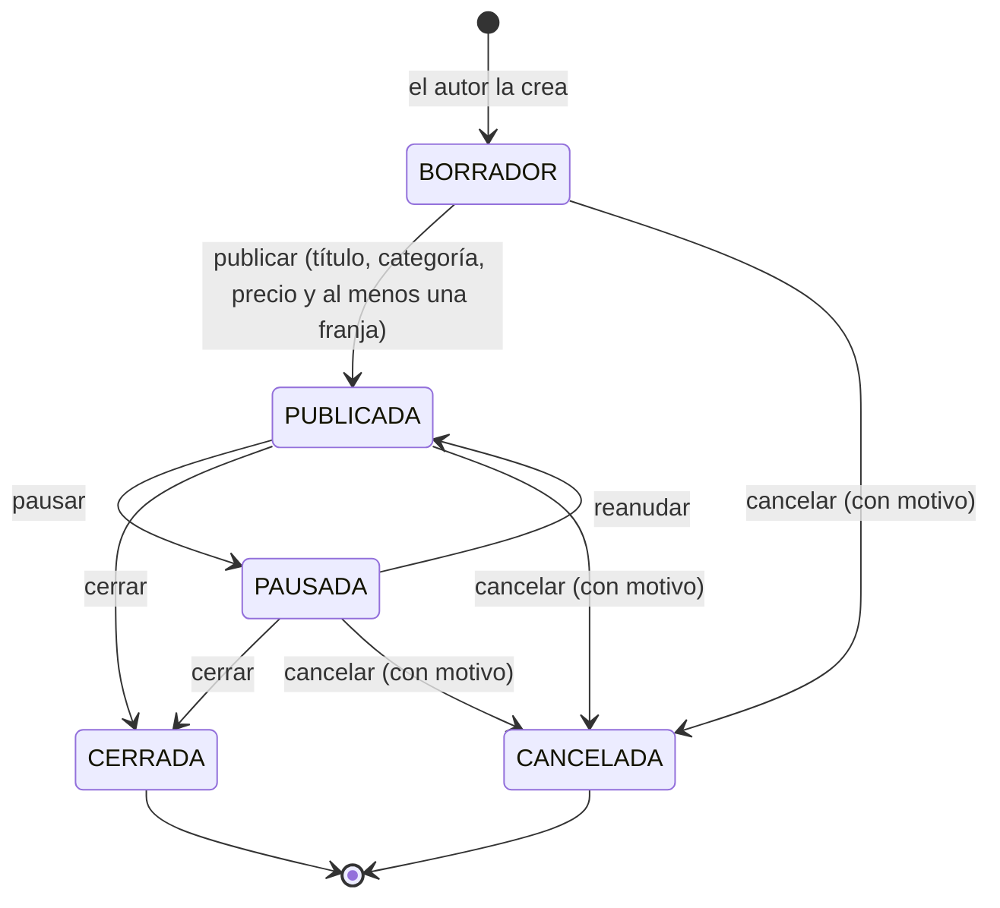

# Publicaciones, catálogo y búsqueda: historias de usuario y estados

Cubre lo que un profesional o una organización ofrece y cómo lo encuentra el resto: el ciclo de vida de una publicación, sus franjas y su cupo, el catálogo de categorías y la búsqueda. Las reglas salen del enunciado (§4.2, §4.3 y §5). Lo que el enunciado no define está en **Decisiones tomadas** al final.

## Actores

- **Profesional**: publica mentorías y servicios.
- **Organización**: publica desafíos.
- **Autor**: quien creó la publicación (un profesional o una organización). Es el único que la edita y le cambia el estado.
- **Usuario**: cualquiera que busca y mira publicaciones. Puede ser cliente de otras publicaciones aunque también sea autor.

## Historias

### HU-P01. Crear una publicación en borrador

**Como** profesional u organización, **quiero** crear una publicación en borrador, **para** prepararla con calma antes de que la vean los demás.

Criterios de aceptación:

1. Cuando creo una publicación, queda en `BORRADOR`, no es visible para nadie más que para mí y su creación queda en el historial con fecha y actor.
2. En borrador puedo dejar datos incompletos: lo obligatorio se exige recién al publicar.
3. Un profesional puede crear mentorías y servicios; una organización, desafíos. Si un profesional intenta crear un desafío (o una organización una mentoría), se rechaza.
4. Un usuario sin perfil no puede crear publicaciones.
5. El cupo es al menos 1, la duración estimada (si la cargo) es positiva y el precio base no puede ser negativo.

### HU-P02. Editar un borrador

**Como** autor, **quiero** editar los datos y las franjas de mi borrador, **para** corregirlo antes de publicarlo.

Criterios de aceptación:

1. Dado un borrador mío, puedo cambiar título, descripción, categoría, modalidad, duración, cupo, precio, etiquetas y franjas.
2. Las franjas de una misma publicación no pueden superponerse.
3. Dada una publicación que no está en `BORRADOR`, cuando intento editarla, se rechaza por transición inválida.
4. Nadie más que el autor puede editarla.

### HU-P03. Publicar

**Como** autor, **quiero** publicar mi borrador, **para** que los usuarios lo encuentren y lo soliciten.

Criterios de aceptación:

1. Dado un borrador con título, categoría, precio base (no negativo) y al menos una franja, cuando lo publico, pasa a `PUBLICADA` y queda visible en la búsqueda.
2. **(Caso de aceptación 2)** Dado un borrador incompleto, cuando intento publicarlo, se rechaza indicando todo lo que falta, y la publicación sigue en `BORRADOR` sin cambios.
3. Una publicación gratuita (precio 0) se puede publicar.
4. La transición queda en el historial con fecha y actor.

### HU-P04. Pausar y reanudar

**Como** autor, **quiero** pausar mi publicación, **para** dejar de recibir solicitudes por un tiempo sin perderla.

Criterios de aceptación:

1. Dada una publicación `PUBLICADA`, cuando la pauso, pasa a `PAUSADA`: solo la veo yo y no admite solicitudes nuevas.
2. Mientras está pausada puedo seguir aceptando las solicitudes que ya tenía pendientes.
3. Dada una publicación `PAUSADA`, cuando la reanudo, vuelve a `PUBLICADA` y sube en el orden "más recientes".

### HU-P05. Cerrar

**Como** autor, **quiero** cerrar mi publicación, **para** darla por terminada.

Criterios de aceptación:

1. Dada una publicación `PUBLICADA` o `PAUSADA`, cuando la cierro, pasa a `CERRADA`.
2. Una publicación `CERRADA` no se puede reabrir, editar ni reservar.

### HU-P06. Cancelar

**Como** autor, **quiero** retirar mi publicación indicando el motivo, **para** que quede claro por qué ya no está.

Criterios de aceptación:

1. Dada una publicación en `BORRADOR`, `PUBLICADA` o `PAUSADA`, cuando la cancelo con un motivo, pasa a `CANCELADA` y el motivo queda en el historial.
2. El motivo es obligatorio: sin motivo, se rechaza y no cambia nada.
3. Una publicación `CANCELADA` no admite ninguna acción.

### HU-P07. Ver el detalle de una publicación

**Como** usuario, **quiero** ver el detalle de una publicación, **para** decidir si la solicito.

Criterios de aceptación:

1. Una publicación `PUBLICADA` la puede ver cualquiera, con sus franjas (libres u ocupadas) y los lugares disponibles.
2. Una publicación en cualquier otro estado solo la ve su autor. Para el resto responde "no encontrada", igual que si no existiera.

### HU-P08. Listar mis publicaciones

**Como** autor, **quiero** ver todas mis publicaciones, **para** administrarlas desde mi panel de proveedor.

Criterios de aceptación:

1. Veo mis publicaciones en todos sus estados, de la más nueva a la más vieja.
2. Puedo filtrar por estado.
3. El listado es paginado.

### HU-P09. Reservar y liberar lugares

**Como** área de contratación, **necesito** reservar y liberar lugares de una publicación, **para** que la aceptación de una solicitud bloquee el cupo.

Criterios de aceptación:

1. Aceptar una solicitud ocupa la franja elegida y descuenta un lugar del cupo.
2. No se puede reservar una franja ocupada ni superar el cupo, aunque queden franjas libres.
3. **(Base del caso de aceptación 4)** Si dos aceptaciones simultáneas compiten por el último lugar, solo una se confirma.
4. Cancelar o reprogramar una contratación libera la franja y el lugar.
5. Una publicación `CERRADA` o `CANCELADA` no admite reservas.
6. El autor no puede solicitar su propia publicación, y solo se solicitan publicaciones `PUBLICADA`.

### HU-P10. Navegar el catálogo de categorías

**Como** usuario, **quiero** que las categorías estén organizadas en un árbol (por ejemplo Tecnología → Backend → Java), **para** buscar de lo general a lo particular.

Criterios de aceptación:

1. Una categoría puede tener subcategorías y habilidades, a cualquier profundidad.
2. Filtrar por una categoría incluye todo lo que cuelga de ella.
3. Una categoría no puede contenerse a sí misma, ningún ítem aparece dos veces en el árbol y dos hermanos no pueden llamarse igual.

### HU-B01. Buscar publicaciones

**Como** usuario, **quiero** buscar publicaciones con filtros, **para** encontrar la que me sirve.

Criterios de aceptación:

1. **(Caso de aceptación 1)** Dada una mentoría publicada, la encuentro filtrando por cualquier combinación de:
   - texto (en título, descripción o etiquetas),
   - categoría (incluye subcategorías),
   - modalidad,
   - rango de precio,
   - habilidad (contra las etiquetas),
   - reputación mínima del autor.
2. Solo aparecen publicaciones `PUBLICADA`.
3. El texto se busca literal y sin distinguir mayúsculas.
4. Filtros inválidos (precio mínimo mayor que el máximo, precios negativos, reputación fuera de 0 a 5, categoría inexistente) se rechazan.

### HU-B02. Ordenar los resultados

**Como** usuario, **quiero** ordenar los resultados, **para** ver primero lo que más me interesa.

Criterios de aceptación:

1. Puedo ordenar por relevancia (por defecto), mejor reputación, menor precio o más reciente.
2. Relevancia: cada publicación suma **+3** si el título contiene el texto, **+2** si alguna etiqueta lo contiene y **+1** si la descripción lo contiene. A igual puntaje desempata la mejor reputación del autor y después la más reciente.
3. Si no escribí texto, "relevancia" ordena por mejor reputación.
4. Un autor sin calificaciones cuenta como reputación 0.

### HU-B03. Paginar los resultados

**Como** usuario, **quiero** ver los resultados por páginas, **para** no recibir todo de una vez.

Criterios de aceptación:

1. Todo listado de consulta es paginado (por defecto 20 por página, hasta 100).
2. Cada página informa el total de resultados, el total de páginas y si hay una siguiente.
3. El orden es estable entre páginas: ninguna publicación se repite ni se saltea.

## Estados de la publicación

En el código, los estados son `DRAFT`, `PUBLISHED`, `PAUSED`, `CLOSED` y `CANCELLED`, y cada uno es una clase del patrón State (`PublicationState`).

### Qué permite cada estado

| Estado | Visible para | Recibe solicitudes | Reserva y libera lugares | Se edita |
| --- | --- | --- | --- | --- |
| `BORRADOR` | Solo el autor | No | No | Sí |
| `PUBLICADA` | Todos | Sí | Sí | No |
| `PAUSADA` | Solo el autor | No | Sí (las pendientes) | No |
| `CERRADA` | Solo el autor | No | No | No |
| `CANCELADA` | Solo el autor | No | No | No |

### Transiciones válidas

| Desde | Acción | Hacia | Quién | Condiciones |
| --- | --- | --- | --- | --- |
| (nueva) | crear | `BORRADOR` | Profesional u organización | El tipo corresponde al tipo de cuenta |
| `BORRADOR` | publicar | `PUBLICADA` | Autor | Título, categoría, precio y al menos una franja |
| `BORRADOR`, `PUBLICADA` o `PAUSADA` | cancelar | `CANCELADA` | Autor | Motivo obligatorio |
| `PUBLICADA` | pausar | `PAUSADA` | Autor | |
| `PAUSADA` | reanudar | `PUBLICADA` | Autor | |
| `PUBLICADA` o `PAUSADA` | cerrar | `CERRADA` | Autor | |

### Transiciones inválidas

Cualquier acción que no esté en la tabla anterior se rechaza con un error de transición inválida y no cambia nada. Por ejemplo:

| Estado | Acción | Por qué no |
| --- | --- | --- |
| `BORRADOR` | pausar, reanudar o cerrar | Todavía no se publicó |
| `PUBLICADA` | publicar o reanudar | Ya está publicada |
| `PUBLICADA` o `PAUSADA` | editar | Solo se edita en borrador |
| `PAUSADA` | pausar o publicar | Ya está pausada; se reanuda |
| `CERRADA` | cualquier acción | Finalizada; no se reabre |
| `CANCELADA` | cualquier acción | Es un estado final |

## Decisiones tomadas

| # | Pregunta | Decisión |
| --- | --- | --- |
| P1 | ¿Cómo se relacionan el cupo y las franjas? (D5 de contratación) | El **cupo es por publicación** (cantidad de contrataciones activas) y **cada franja la toma una sola contratación**. Los lugares reservados se calculan a partir de las franjas ocupadas. |
| P2 | ¿Cómo se calcula la relevancia? | +3 título, +2 etiqueta, +1 descripción; desempata la reputación y después la fecha. Sin texto, se ordena por reputación. |
| P3 | ¿Desde qué estados se cancela? | Desde `BORRADOR`, `PUBLICADA` y `PAUSADA`, siempre con motivo. `CERRADA` ya es final. |
| P4 | ¿Qué pasa con las solicitudes pendientes al pausar? | Se pueden seguir aceptando: pausar solo corta las solicitudes **nuevas**. |
| P5 | ¿Qué ve alguien que pide una publicación ajena no publicada? | "No encontrada", igual que si no existiera, para no revelar que existe. |
| P6 | ¿Cómo se filtra por habilidad? | Contra las etiquetas de la publicación: son las habilidades que ofrece. |
| P7 | ¿Cómo se evita la sobreventa del último lugar? | Optimistic locking con `@Version` sobre la publicación. Reservar fuerza el incremento de versión, así la segunda aceptación concurrente falla al confirmar. |
