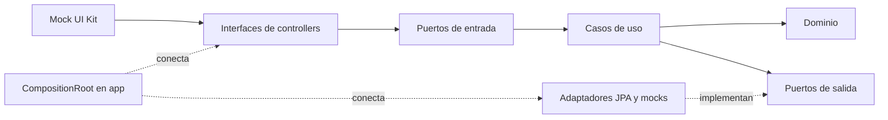
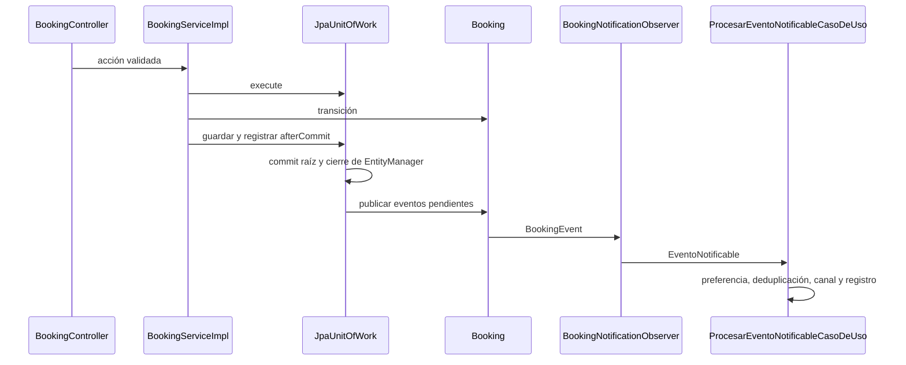

# Tarea 89 — Casos de uso y puertos actuales

Bosquejo actualizado para trasladar a StarUML. La aplicación usa los módulos Maven `domain`, `application`, `infrastructure`, `controllers` y `app`. Los comandos y vistas viven en `application.dto`; las entradas en `application.ports.in`, las salidas en `application.ports.out` y los servicios en `application.usecases`.

| Área | Entradas principales | Servicios | Salidas |
| --- | --- | --- | --- |
| Perfil | CreateProfileUseCase, UpdateProfileUseCase, ManageSkillsUseCase, DeactivateProfileUseCase, GetPublicProfileUseCase | Servicios de perfil y GetPublicProfileFacade | ProfileRepository, ActivePublicationsQuery, RatingRepository, UnitOfWork |
| Publicación | CreateDraftUseCase, EditDraftUseCase, ChangePublicationStatusUseCase, GetPublicationUseCase, ListMyPublicationsUseCase | Servicios de publicación | PublicationRepository, AuthorProfileQuery, UnitOfWork |
| Búsqueda y recomendación | SearchPublicationsUseCase, RecommendPublicationsUseCase, RecommendationStrategy | SearchPublicationsService, RecommendPublicationsService; afinidad/popularidad | PublicationSearchQuery, CategoryTree, RecommendationMetadataQuery |
| Contratación | BookingService | BookingServiceImpl | BookingRepository, PublicationCatalog, PublicationAvailability, WalletRepository, UnitOfWork, BookingPricingPolicy |
| Wallet y comprobante | LoadWalletUseCase, GetWalletUseCase, GetBookingReceiptUseCase | LoadWalletService, GetWalletService, GetBookingReceiptService | WalletRepository, BookingRepository, SkillCoinGateway, UnitOfWork |
| Calificación | RegisterRatingUseCase, ListRatingsUseCase | RegisterRatingService, ListRatingsService | RatingRepository, ProfileRepository, EligibleBookingQuery, UnitOfWork |
| Notificaciones | BandejaNotificacionEntrada, PreferenciaNotificacionEntrada, ProcesarEventoNotificableEntrada | Casos de uso de bandeja, preferencias y procesamiento | RepositorioNotificaciones, RepositorioPreferencias, CanalNotificacion |

Los controllers validan la identidad mock y la entrada; los casos de uso comprueban las reglas y pertenencia sobre datos cargados. Las consultas devuelven DTO y `Page<T>`; nunca entidades JPA. Las estrategias y repositorios dependen de sus contratos internos, no de la UI ni de MySQL.

## Observer y notificaciones

Multiplicidades para el UML: una contratación tiene dos participantes y muchas transiciones; cada instancia tiene cero o más observers; cada evento notificable identifica dos destinatarios de la contratación; la base admite una notificación por evento/destinatario. Una preferencia corresponde a un usuario y un canal. La fábrica recibe tres adaptadores y selecciona uno según preferencia.

`ApplicationControllers` agrupa las interfaces para las pantallas. `CompositionRoot` crea implementaciones concretas y `ApplicationRuntime` cierra los recursos. La elección de canal se realiza mediante un controller que obtiene el usuario de la sesión, sin permitir seleccionar un destinatario ajeno.

Los diagramas `.mdj` compartidos corresponden a las tareas de Luqui; este documento entrega el bosquejo actualizado y no reemplaza esa entrega.
