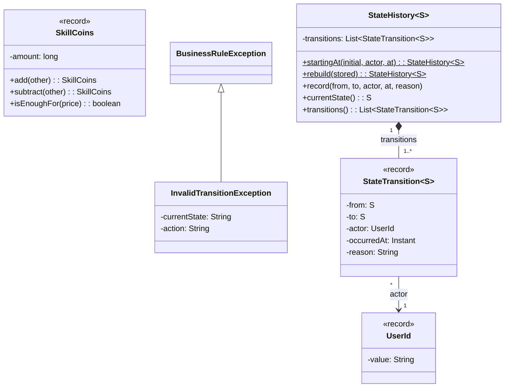
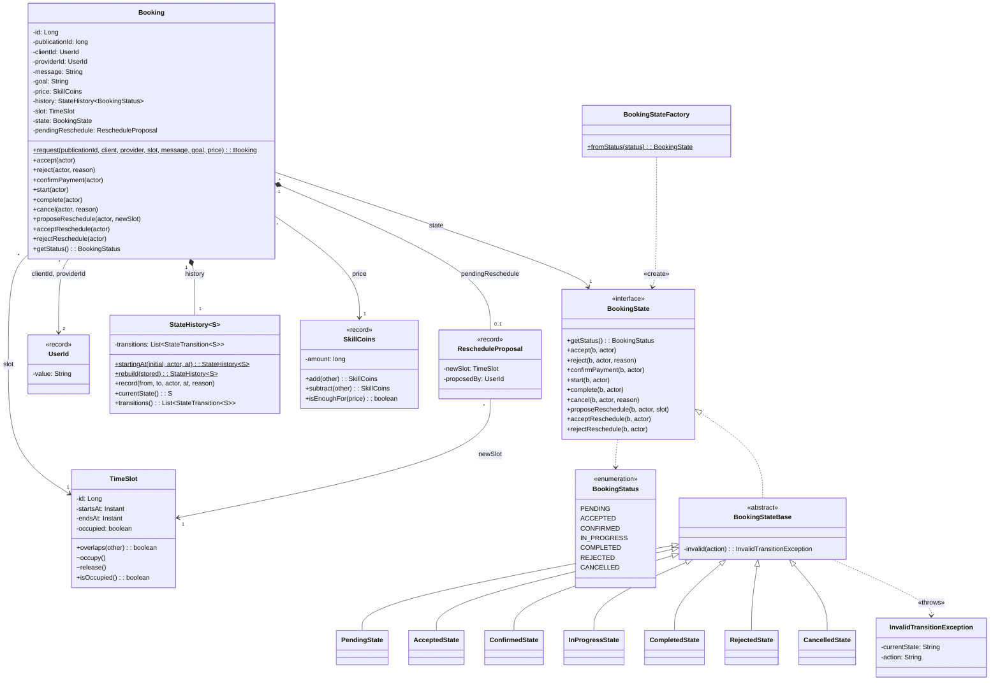
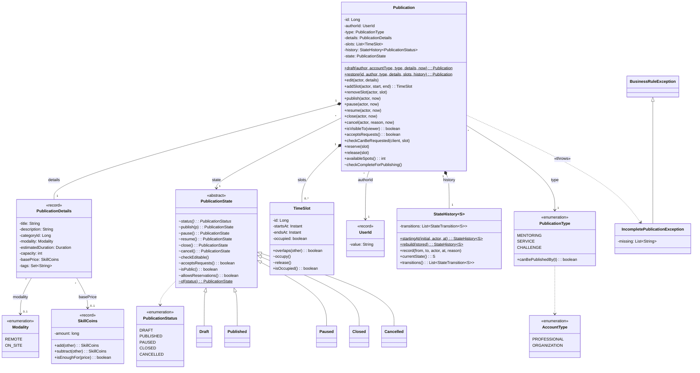
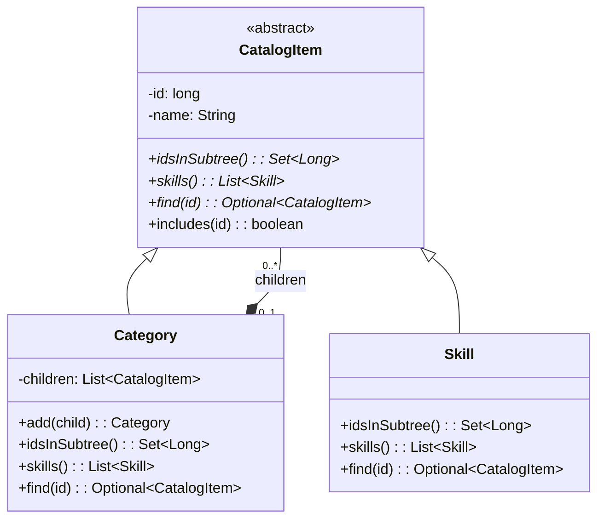
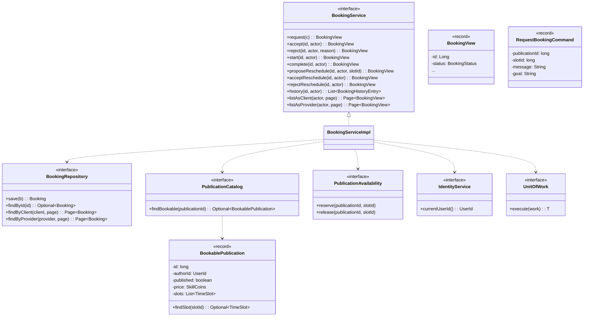

# Modelo de clases de SkillSwap

Diagramas de clases de **dominio** y **aplicación** generados a partir del código, con los mismos elementos que `skillswap.mdj` (StarUML). GitHub los renderiza para revisarlos sin abrir StarUML.

Patrones que se ven en los diagramas:

- **State**: `BookingState` y sus estados (contratación); `PublicationState` y sus estados (publicación).
- **Composite**: `CatalogItem` → `Category` (compuesto) y `Skill` (hoja).
- **Puertos y adaptadores (Clean Architecture)**: casos de uso como interfaces de entrada, repositorios y consultas como puertos de salida.

## Dominio - Común

## Dominio - Contratación

## Dominio - Publicaciones

## Dominio - Catálogo

## Aplicación - Publicaciones

```mermaid
classDiagram
    class CreateDraftUseCase["CreateDraftUseCase"] {
        <<interface>>
        +createDraft(c): PublicationView
    }
    class EditDraftUseCase["EditDraftUseCase"] {
        <<interface>>
        +editDraft(c): PublicationView
    }
    class ChangePublicationStatusUseCase["ChangePublicationStatusUseCase"] {
        <<interface>>
        +changeStatus(c): PublicationView
    }
    class GetPublicationUseCase["GetPublicationUseCase"] {
        <<interface>>
        +get(viewer, id): PublicationView
    }
    class ListMyPublicationsUseCase["ListMyPublicationsUseCase"] {
        <<interface>>
        +listMine(author, status, page): Page~PublicationView~
    }
    class SearchPublicationsUseCase["SearchPublicationsUseCase"] {
        <<interface>>
        +search(f): Page~PublicationSummary~
    }
    class CreateDraftService["CreateDraftService"] {
    }
    class EditDraftService["EditDraftService"] {
    }
    class ChangePublicationStatusService["ChangePublicationStatusService"] {
    }
    class GetPublicationService["GetPublicationService"] {
    }
    class ListMyPublicationsService["ListMyPublicationsService"] {
    }
    class SearchPublicationsService["SearchPublicationsService"] {
    }
    class PublicationRepository["PublicationRepository"] {
        <<interface>>
        +findById(id): Optional~Publication~
        +save(p): Publication
        +findByAuthor(author, status, page): Page~Publication~
    }
    class UnitOfWork["UnitOfWork"] {
        <<interface>>
        +execute(work): T
    }
    class AuthorProfileQuery["AuthorProfileQuery"] {
        <<interface>>
        +accountTypeOf(user): Optional~AccountType~
    }
    class PublicationSearchQuery["PublicationSearchQuery"] {
        <<interface>>
        +search(c, page): Page~PublicationSummary~
    }
    class CategoryTree["CategoryTree"] {
        <<interface>>
        +idsUnder(categoryId): Optional~Set~Long~~
    }
    class CreateDraftCommand["CreateDraftCommand"] {
        <<record>>
        -authorId: UserId
        -type: PublicationType
        -details: PublicationDetails
        -slots: List~SlotInput~
    }
    class ChangePublicationStatusCommand["ChangePublicationStatusCommand"] {
        <<record>>
        -actorId: UserId
        -publicationId: long
        -action: PublicationAction
        -reason: String
    }
    class PublicationAction["PublicationAction"] {
        <<enumeration>>
        PUBLISH
        PAUSE
        RESUME
        CLOSE
        CANCEL
    }
    class SearchFilters["SearchFilters"] {
        <<record>>
        -text: String
        -categoryId: Long
        -modality: Modality
        -minPrice: Long
        -maxPrice: Long
        -skill: String
        -minReputation: Double
        -sort: SearchSort
        -page: PageRequest
    }
    class SearchSort["SearchSort"] {
        <<enumeration>>
        RELEVANCE
        BEST_REPUTATION
        LOWEST_PRICE
        MOST_RECENT
    }
    class PageRequest["PageRequest"] {
        <<record>>
        -number: int
        -size: int
        +offset(): long
    }
    class Page["Page&lt;T&gt;"] {
        <<record>>
        -items: List~T~
        -request: PageRequest
        -totalItems: long
        +totalPages(): long
        +hasNext(): boolean
        +map(f): Page~R~
    }
    class PublicationSummary["PublicationSummary"] {
        <<record>>
        -id: long
        -title: String
        -authorReputation: double
        -basePrice: long
        -availableSpots: int
        -publishedAt: Instant
        ...
    }
    class PublicationView["PublicationView"] {
        <<record>>
        -id: Long
        -authorId: String
        -status: PublicationStatus
        -title: String
        -availableSpots: int
        -slots: List~SlotView~
        ...
        +from(p): PublicationView$
    }
    CreateDraftUseCase <|.. CreateDraftService
    EditDraftUseCase <|.. EditDraftService
    ChangePublicationStatusUseCase <|.. ChangePublicationStatusService
    GetPublicationUseCase <|.. GetPublicationService
    ListMyPublicationsUseCase <|.. ListMyPublicationsService
    SearchPublicationsUseCase <|.. SearchPublicationsService
    CreateDraftService ..> PublicationRepository
    EditDraftService ..> PublicationRepository
    ChangePublicationStatusService ..> PublicationRepository
    GetPublicationService ..> PublicationRepository
    ListMyPublicationsService ..> PublicationRepository
    CreateDraftService ..> UnitOfWork
    EditDraftService ..> UnitOfWork
    ChangePublicationStatusService ..> UnitOfWork
    CreateDraftService ..> AuthorProfileQuery
    SearchPublicationsService ..> PublicationSearchQuery
    SearchPublicationsService ..> CategoryTree
    ChangePublicationStatusCommand "*" --> "1" PublicationAction : action
    SearchFilters "*" --> "1" SearchSort : sort
    SearchFilters "*" --> "1" PageRequest : page
    Page "*" --> "1" PageRequest : request
```

## Aplicación - Contratación

